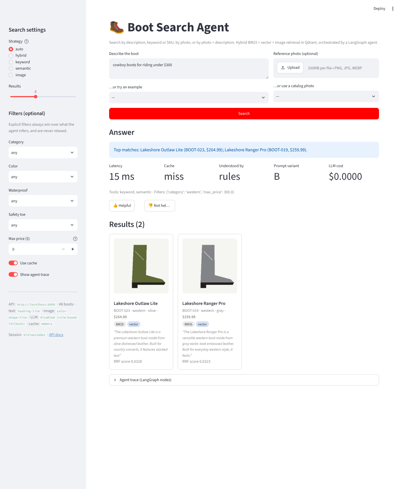
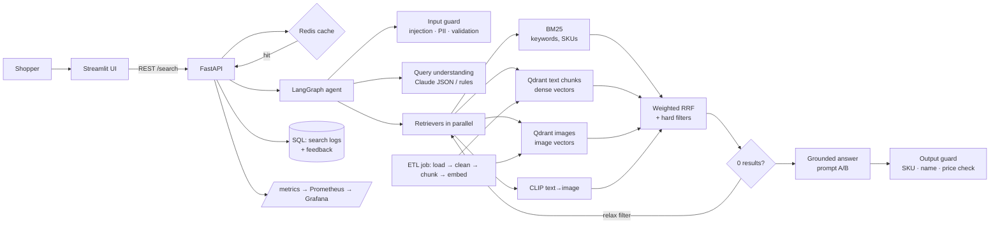

# 🥾 Boot Search Agent

**Agentic, multimodal product search** over a boot catalog. Search by description, by keyword or SKU,
by photo, or by **photo + description together**. A LangGraph agent decides which retrievers to use,
extracts filters, fuses the results, retries when nothing matches, and writes a grounded answer that is
checked for hallucinations before it reaches the user.



| | |
|---|---|
| **Retrieval** | BM25 keyword search · dense text vectors · image vectors · CLIP text→image, fused with weighted Reciprocal Rank Fusion |
| **Vector DB** | Qdrant (embedded for tests, Docker locally, Qdrant Cloud in prod), payload-filtered HNSW search |
| **Agent** | LangGraph state machine: guard → understand → retrieve ⟲ reflect → generate → verify |
| **LLM** | Anthropic Claude (optional — falls back to rules + templates, so the demo never breaks) |
| **API / UI** | FastAPI (OpenAPI docs, metrics, feedback) · Streamlit thin client |
| **Ops** | Docker, Docker Compose, Vercel containers, Kubernetes, GitHub Actions, Prometheus + Grafana, DVC |
| **Images** | 8–10 photos per boot (side, front, back, sole, top, close-ups), one vector per photo, grouped MaxSim search, multi-photo queries |
| **Quality** | 47 tests, text + image evals, CI quality gates, LLM-as-judge + A/B prompts |

---

## Quickstart (2 minutes, no API keys, no Docker)

```bash
python -m venv .venv && source .venv/bin/activate
make install                      # pip install -r requirements/dev.txt
make test                         # 47 tests incl. the text and image quality gates
make api                          # terminal 1 → http://localhost:8000/docs
make ui                           # terminal 2 → http://localhost:8501
```

The API indexes the catalog into an in-process Qdrant on startup. Add `ANTHROPIC_API_KEY` to `.env`
to turn on LLM query understanding and answer writing. Set `EMBEDDING_BACKEND=clip` (after
`make install-clip`) for real semantic and cross-modal search with Hugging Face models.

**Full stack in Docker** (Qdrant server, Redis, ingest job, API, UI):
```bash
docker compose up --build                          # UI :8501 · API :8000 · Qdrant :6333/dashboard
docker compose --profile monitoring up --build     # + Prometheus :9090 + Grafana :3000
```

**Deploy to Vercel** (API + UI as two container services in one project): see
[docs/DEPLOYMENT.md](docs/DEPLOYMENT.md).

---

## Architecture



Search modes:

| You give it | What runs |
|---|---|
| "waterproof hiking boots under $200" | filters extracted (`hiking`, `waterproof`, `≤$200`) → BM25 + text vectors (+ CLIP text→image) → RRF |
| "BOOT-042" or "kiltie lace guard" | intent = keyword lookup → BM25 weighted ×2 |
| a photo | every product photo is searched, photos are grouped by boot, a boot scores by its best-matching photo (MaxSim) |
| several photos of one boot (e.g. side + sole) | each photo searched separately, boot score = average of its best match per photo |
| a photo + "but waterproof" | image (weight 1.5) + BM25 + text vectors, `waterproof` enforced on all of them |
| something impossible ("navy western boots under $100") | empty → agent relaxes a filter, retries, and says what it relaxed |
| "ignore previous instructions…" | blocked by the input guard before any LLM call |

---

## How this project maps to the AI-engineer skill list

| Skill | Where it lives |
|---|---|
| Prompt engineering | `app/agent/prompts.py` — structured JSON output, few-shot, grounding, injection-safe tags, versioned prompts |
| Embeddings & vector representations | `app/embeddings/` — interface + lite (hashing, colour/shape) + Hugging Face (MiniLM, OpenCLIP) |
| RAG | `app/agent/graph.py` — retrieve → grounded generation → verification |
| Vector database (Qdrant) | `app/retrieval/qdrant_store.py` — collections, payload indexes, filter pushdown, idempotent upserts, `query_points_groups` for multi-photo products |
| Multi-image products | `scripts/generate_sample_data.py` (8–10 views), `app/ingestion/pipeline.py::index_images`, `app/retrieval/search_engine.py::combine_query_images`, `app/evaluation/image_eval.py` |
| Keyword search (BM25) | `app/retrieval/bm25_index.py` |
| Hybrid search / fusion | `app/retrieval/fusion.py` (RRF), `app/retrieval/search_engine.py` |
| Document loaders & chunking | `app/ingestion/loaders.py` (JSON/CSV/HTTP), `app/ingestion/chunking.py` (section-aware + recursive) |
| LangGraph agent | `app/agent/graph.py` — tool selection, reflection loop, bounded steps |
| FastAPI | `app/api/main.py` — health/ready, search, feedback, metrics, rate limit, API key |
| Hugging Face ecosystem | `app/embeddings/clip.py` — sentence-transformers + OpenCLIP from the HF Hub |
| Streamlit UI / UX for AI | `ui/streamlit_app.py` — sources, evidence, trace, feedback, user overrides |
| Docker / Compose / Kubernetes | `docker/`, `docker-compose.yml`, `k8s/` (StatefulSet, Job, HPA, probes, Ingress) |
| Cloud | `vercel.json` + `docker/Dockerfile.api.vercel` + `ui/Dockerfile.vercel`; K8s manifests run on EKS/GKE/AKS |
| Data collection & ETL | `app/ingestion/pipeline.py`, `scripts/ingest.py` |
| Data cleaning | `app/ingestion/cleaning.py` — normalise, coerce, validate, dedup, reject report |
| SQL & NoSQL | SQLAlchemy (`app/storage/feedback.py`) + Qdrant payload store + Redis |
| Data versioning (DVC) | `dvc.yaml` + `manifest.json` lineage (input hash, pipeline version, model) |
| Caching | `app/cache/cache.py` — Redis with in-memory fallback, versioned keys |
| CI/CD | `.github/workflows/ci.yml` — lint, tests, eval summary, GHCR images, optional Vercel deploy |
| Monitoring & logging | `app/api/metrics.py`, `monitoring/` (Grafana dashboard), JSON logs with request ids |
| LLM evaluation | `app/evaluation/retrieval_eval.py`, `app/evaluation/llm_eval.py` (Ragas or LLM-as-judge) |
| Prompt A/B testing | stable per-session variant in `app/api/main.py`, results at `GET /feedback/stats` |
| Hallucination detection & guardrails | `app/guardrails/output_guard.py`, `app/guardrails/input_guard.py` |
| Observability (traces) | per-node trace returned with every response and shown in the UI |
| Cost & latency | token/cost metrics, cache, small model for extraction, LLM off the path for explicit modes |
| Continuous improvement loop | feedback → review queue → golden set → CI gate |
| Prompt injection & data security | input guard, data-not-instructions prompts, PII redaction, HTML escaping, path-traversal-safe files |
| Human-in-the-loop | clarifying questions, thumbs up/down, `GET /feedback/review` |
| Privacy (GDPR) | PII redacted before logs/LLM/cache, only redacted queries stored, no user identifiers |

Not built (and said honestly in [docs/INTERVIEW_GUIDE.md](docs/INTERVIEW_GUIDE.md) with how I'd add them):
Kafka/Kinesis streaming ingestion, a feature store, vLLM/TGI self-hosted generation, a learned re-ranker.

---

## Evaluation results

`make eval` — 15 golden queries, lite embedder (no neural models):

| system | P@5 | R@10 | MRR | nDCG@10 |
|---|---|---|---|---|
| keyword (BM25) | 0.813 | 0.758 | 0.956 | 0.807 |
| semantic (vectors) | 0.600 | 0.611 | 0.867 | 0.663 |
| hybrid (RRF) | 0.747 | 0.730 | 1.000 | 0.788 |
| **agent** (filters + hybrid + reflection) | **0.867** | **0.883** | **1.000** | **0.913** |

Read this honestly: with the *lexical* lite embedder, the vector side adds little over BM25, so hybrid
mainly improves MRR. The big jump comes from the agent's **structured filter extraction**. With the
`clip` backend the semantic retriever handles paraphrases ("boots for linemen" → logger boots) that BM25
misses, which is the point of hybrid search. Re-run `make eval` after switching backends to compare.


### Image search: one photo per boot vs every photo

`make image-eval` — 192 held-out "shopper photos" (new shots of a boot from one of its angles, never
indexed), searched against 437 catalog photos:

| index strategy | product@1 | product@5 | MRR |
|---|---|---|---|
| one photo per boot (side view) | 0.667 | 0.927 | 0.777 |
| **every photo, MaxSim** (default) | **0.771** | 0.901 | **0.832** |
| every photo, mean of best 3 | 0.693 | 0.911 | 0.790 |

Indexing every angle lets a photo of a sole or a toe close-up match the catalog's sole or toe
photo of the same boot. The eval also runs an "unseen angle" stress test (the catalog has no photo
from the query's angle): there the single side photo wins (MRR 0.75 vs 0.50), because the other
boots' photos from that angle compete. Both results are in `data/eval/image_report.json`.

---

## Project layout

```
app/
  core/         config (env-driven), domain models, JSON logging, composition root
  ingestion/    loaders → cleaning → chunking → pipeline (ETL)
  embeddings/   interface, lite backend, Hugging Face backend, factory
  retrieval/    Qdrant store, BM25, RRF fusion, SearchEngine (the agent's tools)
  agent/        LangGraph graph, prompts, rule parser, LLM client
  guardrails/   input (injection, PII, image validation) and output (grounding) checks
  cache/        Redis / in-memory response cache
  storage/      SQL search logs + feedback (HITL, A/B)
  api/          FastAPI app, schemas, Prometheus metrics
  evaluation/   retrieval metrics, LLM-as-judge / Ragas, prompt A/B
ui/             Streamlit thin client (+ Dockerfile.vercel)
scripts/        sample data generator, ingest CLI
tests/          unit, integration, quality gate
docker/ k8s/ monitoring/ .github/   deployment and operations
docs/           ARCHITECTURE.md · INTERVIEW_GUIDE.md · DEPLOYMENT.md
```

The data is synthetic (48 boots with 437 photos, generated deterministically by
`scripts/generate_sample_data.py`, fictional brands) so the repo is safe to make public. Point `scripts/ingest.py --source` at a real
catalog JSON, CSV or REST endpoint to use your own.
